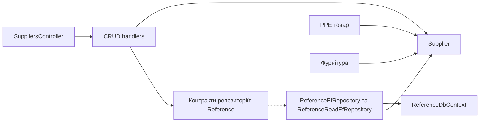

# Постачальники

**Статична звірка з кодом:** 2026-10-16. **Модуль:** reference.

CRUD-операції та читання списку для довідника «Постачальники».

## Будова й зв'язки

[Controller](../../../../src/Modules/Reference/Reference.Api/Reference.Api/Controllers/SuppliersController.cs) відкриває CRUD. [create handler](../../../../src/Modules/Reference/Reference.Application/Reference.Application/Features/Supplier/Create/CreateSupplierCommandHandler.cs) і сусідні query/update/delete handlers перевіряють дані; [Supplier](../../../../src/Modules/Reference/Reference.Domain/Reference.Domain/Suppliers/Entities/Supplier.cs) є доменною сутністю. [ReferenceEfRepository](../../../../src/Modules/Reference/Reference.Infrastructure/Reference.Infrastructure/Repositories/ReferenceEfRepository.cs) та [ReferenceDbContext](../../../../src/Modules/Reference/Reference.Infrastructure/Reference.Infrastructure/DataBase/ReferenceDbContext.cs) зберігають її. Постачальник використовується як зовнішній довідник для PPE-товарів і фурнітури.

## Структура в коді

Наведено перевірені точки входу та ключові складові фічі; дерево не перелічує всі допоміжні файли.

```text
src/
└── Modules/Reference/
    ├── Reference.Api/Reference.Api/Controllers/SuppliersController.cs  # HTTP-вхід
    ├── Reference.Application/Reference.Application/Features/Supplier/
    │   ├── Create/CreateSupplierCommandHandler.cs  # обробник сценарію
    │   ├── Delete/DeleteSupplierCommandHandler.cs  # обробник сценарію
    │   ├── GetList/GetSuppliersQueryHandler.cs  # обробник сценарію
    │   └── Update/UpdateSupplierCommandHandler.cs  # обробник сценарію
    ├── Reference.Domain/Reference.Domain/Suppliers/Entities/Supplier.cs  # доменна модель
    └── Reference.Infrastructure/Reference.Infrastructure/
        ├── DataBase/ReferenceDbContext.cs  # контекст даних
        └── Repositories/ReferenceEfRepository.cs  # доступ до даних
```

## Схема будови



## Пов'язані джерела

[OpenAPI](../../contracts/reference/suppliers.openapi.yaml) · [Межі Reference](../../architecture/overview/modules.md).
