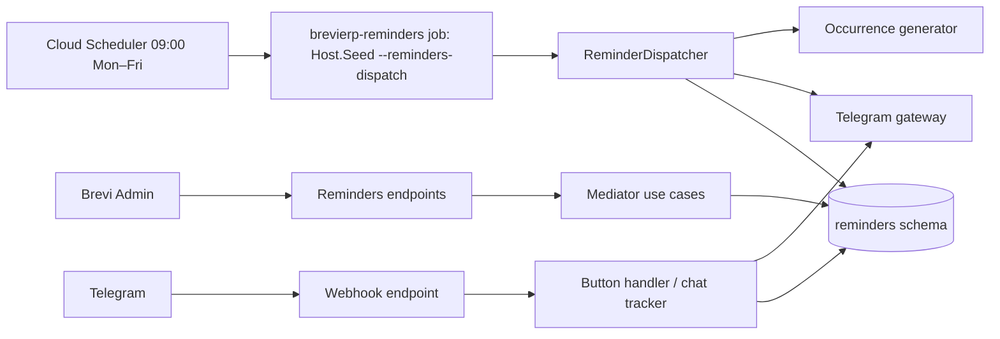

# Telegram reminders

Admin keeps recurring deadline tasks (ПП «Бреві», ФОП Согоконь, personal). On working days at 09:00 Kyiv the `Host.Seed --reminders-dispatch=true` run posts one Telegram card per task whose reminder window is open. Buttons «✅ Виконано» and «⏰ Нагадати пізніше» come back through the Host.Api webhook; who pressed and when is stored per period. [SDD](../../specs/reminders/001-telegram-reminders/README.md), [contract](../../contracts/reminders/telegram-reminders.openapi.yaml), [runbook](../../operations/jobs/telegram-reminders.md), [tables](../../architecture/data-model/reminders.md).

## Code structure

```text
src/Modules/Reminders/
  Reminders.Domain/Reminders.Domain/
    Calendar/          # WorkingCalendar (Mon–Fri minus NonWorkingDay)
    Schedules/         # ReminderPeriod, ReminderPeriodicity, DueRule (+kind)
    Tasks/             # ReminderTask, ReminderSchedule, ReminderOrganization
    Occurrences/       # ReminderOccurrence (one period), ReminderAction journal, ReminderActor
    Chats/             # ReminderChat (discovered, approved, receives site requests)
    Dispatching/       # ReminderPlanner (should remind, notice), ReminderSnooze, SentReminderMessage
    ReminderTime.cs    # Kyiv time zone
  Reminders.Application/Reminders.Application/
    Abstractions/      # IRemindersDbContext, ITelegramGateway, ReminderClock, webhook settings
    Features/          # Commands/<UseCase>, Queries/<UseCase>, Shared/ per feature
      Tasks/           # GetReminderTasks, Create/Update/ArchiveReminderTask, PreviewReminderDueDates, AssignReminderChat; Shared/ (mapper, validators, chat lookup, ReminderCodes)
      Occurrences/     # GetReminderOccurrences, Close/ReopenReminderOccurrence (+ ReminderOccurrenceStatusChanger updates live cards)
      Chats/           # GetReminderChats, UpdateReminderChat (approve, rename), SendReminderChatTest
      Calendar/        # GetNonWorkingDays, Add/RemoveNonWorkingDay; Shared/WorkingCalendarLoader
      Dispatch/Shared/ # ReminderOccurrenceGenerator, ReminderDispatcher (daily run)
      Dispatch/Commands/DispatchReminders/ # the daily run as one command
      Messages/Shared/ # ReminderMessageFormatter (Ukrainian HTML card, keyboards), ReminderCallbackData
      Telegram/        # HandleTelegramUpdate (buttons, chat tracker), ConnectTelegramWebhook; Shared/ update DTOs
      Access/Shared/   # ReminderAdmin
  Reminders.Infrastructure/Reminders.Infrastructure/
    Persistence/       # RemindersDbContext (schema reminders), configurations, migrations, Seeding/ (25 default tasks)
    Integrations/Telegram/ # TelegramOptions, TelegramBotApiGateway (HttpClient)
    DependencyInjection/
  Reminders.Api/Reminders.Api/
    Endpoints/{Tasks,Occurrences,Chats,Calendar}/   # Admin endpoints under /api/reminders, one <UseCase>/ folder each
    Endpoints/Telegram/   # ReceiveTelegramUpdateEndpoint (anonymous, secret header), ConnectTelegramWebhookEndpoint
src/Bootstrapper/Host.Seed/Jobs/RemindersDispatchCommandRunner.cs   # thin runner: sends DispatchRemindersCommand, logs the summary
```

## Structure diagram



## Tests

`tests/UnitTests/Reminders/`: schedule and all 25 default deadlines, planner and snooze, dispatcher (SQLite in memory, fake clock, fake Telegram), button handler. Command: `dotnet test tests/UnitTests/UnitTests.csproj --filter "FullyQualifiedName~UnitTests.Reminders"`. Module references and schema: `tests/ArchitectureTests/Modules/Office/RemindersDependencyTests.cs`.
