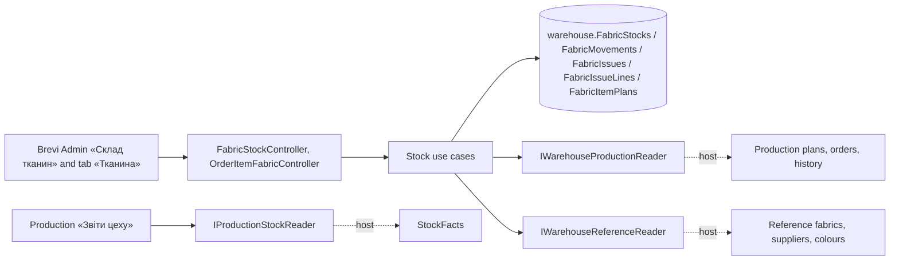

# Fabric stock «Склад тканин» (Warehouse module)

Metres of each fabric of «Тканини» (by FAB- code) in each colour. A pair is a fabric (canonical code; FAB-067 is FAB-023 and FAB-077 is FAB-078) in a normalised colour; its lines keep their own codes. Balances change only through movements: opening (once per pair, zero allowed), receipt of the offer picked, issue without an order (may go below zero), issue to an order item, «Уточнити» to a counted total with a reason, and reversal. Openings, receipts, corrections and issues without an order can be edited (date, metres, supplier/document or purpose, the offer and colour of a receipt, the pair of an issue), voided («Скасувати», kept with no effect) and restored to the state before the last change; each change is a revision with values before and after. Each movement keeps before / change / after, the operation date apart from the record time, and the person; a line's chain runs by operation date. Every form sends an operation id, so a repeat never moves the fabric twice. Open orders of «Швейний цех» reserve their plan until issues cover it. Fabric goes to an item by actual cutting («Видача на завдання» in «Рух тканини» or the «Тканина» tab): the products cut and the real pairs; each planned part is compared with P × n / N, lines are «планова», «заміна» or «додаткова»; the item plan is saved at the first issue and changes by «Оновити план»; order-issue movements can be edited and voided too. Everyone with access reads «Залишки», «Рух тканини» and «Початкові залишки»; the head of the workshop and Admin write. The old «Цех» stock moves in through an import. Own module and schema since [WH-001](../../specs/warehouse/001-warehouse-module/README.md) (first in [PRD-004](../../specs/production/004-fabric-stock/README.md)); ledger rules [WH-002](../../specs/warehouse/002-ledger-rules/README.md); edits [WH-003](../../specs/warehouse/003-movement-revisions/README.md); issue by cutting [WH-004](../../specs/warehouse/004-issue-by-cutting/README.md); [contract](../../contracts/warehouse/fabric-stock.openapi.yaml), [tables](../../architecture/data-model/warehouse.md).

## Code structure

```text
src/Modules/Warehouse/
  Warehouse.Domain/Warehouse.Domain/Stock/
    FabricStock.cs               # line + its movements: Move, Reverse, Transfer, Restate (chain by date); version
    FabricMovement.cs            # kinds, details, before/change/after, destination, operation id, reversal mark
    FabricAliases.cs             # reviewed alias groups FAB-023/067, FAB-078/077 and their identity
    StockPair.cs                 # pair of a group and colour: Open, Receive, Issue, Adjust; spending order; version
    FabricMovementRevision.cs    # edit / void / restore with the state before and after
    StockOperation.cs            # form submission by operation id (repeat → saved result)
    FabricIssue.cs               # «Видача» package by cutting + lines over movements (Planned/Replacement/Additional), reversal
    FabricItemPlan.cs            # saved plan of an item (parts, layers), comparison plan P × n / N
    StockColor.cs                # colour text and NFC key
  Warehouse.Application/Warehouse.Application/
    Abstractions/                # IWarehouseDbContext; ports IWarehouseProductionReader, IWarehouseReferenceReader, IWarehouseStaffReader
    Access/WarehouseActor.cs     # CanMoveStock, SeesStockValue, CanImport, CanIssueFabric(item)
    Colors/WarehouseColors.cs    # a new line takes a colour of «Кольори» (REF-006)
    Contracts/FabricStockContracts.cs
    Stock/
      StockReservations.cs       # plans of «Нове» items (from Production) minus what issues covered
      StockChanges.cs            # actor, offer check, line lookup or creation, save with 409
      StockPairs.cs              # load a pair, restate touched ledgers, save with the operation
      StockOperations.cs         # request hash and replay
      StockRules.cs, StockList.cs
      Opening, Receipts, OneOff, Adjustments  # the pair commands
      Revisions                  # MovementRevisions, edit, void, restore, «Історія правок»
      GetStock («Залишки»), GetChoices, Movements («Рух тканини» page, «Сторно»),
      Issues (ItemPlans, ItemFabricCards, items search, card, issue by cutting, «Оновити план», reversal), Consumption (period summary), ImportStock (old «Цех»)
      Facts/StockFacts.cs        # issues of a period and balances at a date for «Звіти цеху»
      StockMessages.cs
  Warehouse.Infrastructure/…/Persistence/  WarehouseDbContext (schema warehouse), FabricStockConfiguration, migrations
  Warehouse.Api/Warehouse.Api/Stock/
    FabricStockController.cs     # /api/warehouse/fabric-stock (policy access:fabric-stock)
    OrderItemFabricController.cs # /api/warehouse/orders/{id}/items/{itemId}/fabric… (policy access:production-orders)
src/Modules/Production/…/FabricPlans/      # FabricPlanParts, PlanColor; ProductionFabricPlans for the stock
src/Bootstrapper/Host.Api/
  Warehouse/WarehouseProductionReader.cs   # ProductionFabricPlans
  Warehouse/WarehouseReferenceReader.cs    # Reference fabrics with price, suppliers, colours
  Warehouse/WarehouseStaffReader.cs        # Identity users
  Production/ProductionStockReader.cs      # StockFacts for «Звіти цеху»
```

## Structure diagram



## Tests

- `tests/UnitTests/Warehouse/WarehouseLedgerTests.cs` — WH-002: opening once per pair, receipt by offer, issue order and shortage, «Уточнити» limits, operation id repeat, chain by date, paging and filters, alias identity, colour key.
- `tests/UnitTests/Warehouse/WarehouseRevisionTests.cs` — WH-003: edit and restatement, date and pair change, void, restore one change at a time, revision guard, signs, access.
- `tests/UnitTests/Warehouse/WarehouseIssueByCuttingTests.cs` — WH-004: plan of a cut once per part, coverage over lines, saved plan and refresh, operation repeat, products limit, edit and void of order-issue movements, split lines keep their pair.
- `tests/UnitTests/Warehouse/WarehouseStockHandlerTests.cs` — receipt and reversal, access and prices, plan by colour, issue purposes, reversal of an issue, import checks and repeat, colours of a new line, stock facts.
- `tests/UnitTests/Warehouse/FabricStockContractTests.cs` — DTOs and operations against the contract.
- `tests/ArchitectureTests/WarehouseDependencyTests.cs` — layers and schema.

Focused run: `dotnet test tests/UnitTests/UnitTests.csproj --filter FullyQualifiedName~UnitTests.Warehouse`.

**Data:** [warehouse schema](../../architecture/data-model/warehouse.md)
