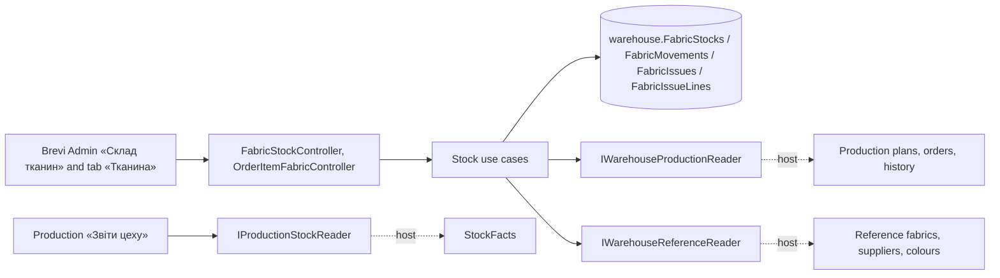

# Fabric stock «Склад тканин» (Warehouse module)

Metres of each fabric of «Тканини» (by FAB- code) in each colour. The balance changes only through movements: opening, receipt from a supplier of «Постачальники», issue to an order item, correction and reversal; each keeps before / change / after, the day and the person. Open orders of «Швейний цех» reserve their plan, computed by Production from the norms by colour, until issues cover it. The «Тканина» tab of an item issues fabric as one package of planned, replacement and additional lines. Managers see the stock; the head of the workshop and Admin move it and see its value. The old «Цех» stock moves in through an import. Own module and schema since [WH-001](../../specs/warehouse/001-warehouse-module/README.md) (first in [PRD-004](../../specs/production/004-fabric-stock/README.md)); [contract](../../contracts/warehouse/fabric-stock.openapi.yaml), [tables](../../architecture/data-model/warehouse.md).

## Code structure

```text
src/Modules/Warehouse/
  Warehouse.Domain/Warehouse.Domain/Stock/
    FabricStock.cs               # line + its movements: Move, Correct, Reverse, Transfer; version
    FabricMovement.cs            # kinds, details, before/change/after, reversal mark
    FabricIssue.cs               # «Видача» package + lines (Planned/Replacement/Additional), reversal
    StockColor.cs                # colour text and key
  Warehouse.Application/Warehouse.Application/
    Abstractions/                # IWarehouseDbContext; ports IWarehouseProductionReader, IWarehouseReferenceReader, IWarehouseStaffReader
    Access/WarehouseActor.cs     # CanMoveStock, SeesStockValue, CanImport, CanIssueFabric(item)
    Colors/WarehouseColors.cs    # a new line takes a colour of «Кольори» (REF-006)
    Contracts/FabricStockContracts.cs
    Stock/
      StockReservations.cs       # plans of «Нове» items (from Production) minus what issues covered
      StockRows.cs               # row with available and value; permissions
      StockChanges.cs            # actor, fabric, line lookup or creation, save with 409, card
      GetChoices, GetStock, GetStockLine, Movements (opening/receipt, correction, reversal),
      Issues (ItemFabricCards, tab query, issue, reversal), Consumption (period summary), ImportStock (old «Цех»)
      Facts/StockFacts.cs        # issues of a period and balances at a date for «Звіти цеху»
      StockMessages.cs
  Warehouse.Infrastructure/…/Persistence/  WarehouseDbContext (schema warehouse), FabricStockConfiguration, migrations
  Warehouse.Api/Warehouse.Api/Stock/
    FabricStockController.cs     # /api/warehouse/fabric-stock (policy access:fabric-stock)
    OrderItemFabricController.cs # /api/warehouse/orders/{id}/items/{itemId}/fabric… (policy access:production-orders)
src/Modules/Production/…/FabricPlans/      # FabricPlanParts, PlanColor; ProductionFabricPlans for the stock
src/Bootstrapper/Host.Api/
  Warehouse/WarehouseProductionReader.cs   # ProductionFabricPlans
  Warehouse/WarehouseReferenceReader.cs    # Reference fabrics with price, suppliers, colours
  Warehouse/WarehouseStaffReader.cs        # Identity users
  Production/ProductionStockReader.cs      # StockFacts for «Звіти цеху»
```

## Structure diagram



## Tests

- `tests/UnitTests/Warehouse/WarehouseStockHandlerTests.cs` — before/change/after, 409, access and value, plan by colour, issue purposes, reversal of an issue, import checks and repeat, colours of a new line, stock facts.
- `tests/UnitTests/Warehouse/FabricStockContractTests.cs` — DTOs and operations against the contract.
- `tests/ArchitectureTests/WarehouseDependencyTests.cs` — layers and schema.

Focused run: `dotnet test tests/UnitTests/UnitTests.csproj --filter FullyQualifiedName~UnitTests.Warehouse`.

**Data:** [warehouse schema](../../architecture/data-model/warehouse.md)
