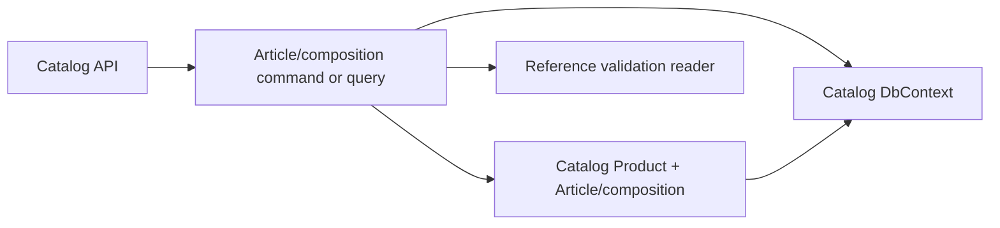

# Design and code responsibilities

## Ownership

Catalog owns Product/model, Article identity and composition associations. Reference remains the owner of fabric, accessory and operation masters. Catalog reads Reference through its existing application contract; it must not duplicate editable Reference names or prices. Costing/Pricing will consume the composition through a defined read contract in a later feature. Existing Product details and storefront reads remain supported during transition.

## Planned flow

Current `ProductsController` uses Product create, full replace and read handlers. Add dedicated Article/composition operations so the current `ProductWriteRequest` does not accidentally wipe new child records. Use one transaction for each composition replacement, with validation before mutation. Return a bounded projection for detail reads; do not load every historical or unrelated Product row.

## Key path map

| Path in BreviERP | State | Responsibility |
| --- | --- | --- |
| `src/Modules/Catalog/Catalog.Domain/Catalog.Domain/Products/Entities/Product.cs` | Existing, change | Preserve Product aggregate; add model code/controlled relation as decided. |
| `src/Modules/Catalog/Catalog.Domain/Catalog.Domain/Products/Entities/Sewing/SewingProductDetails.cs` | Existing, change or adapt | Current fabric/accessory/operation links; ensure one authoritative write path. |
| `src/Modules/Catalog/Catalog.Domain/Catalog.Domain/Products/Entities/Sewing/` | Planned files | Article and composition domain records with typed IDs. |
| `src/Modules/Catalog/Catalog.Application/Catalog.Application/Features/Product/` | Existing plus planned use cases | Dedicated Article/composition commands, queries, validation and Reference reads. |
| `src/Modules/Catalog/Catalog.Api/Catalog.Api/Controllers/ProductsController.cs` | Existing, change or split | HTTP boundary; keep current routes stable, add nested operations only after contract review. |
| `src/Modules/Catalog/Catalog.Infrastructure/Catalog.Infrastructure/Congigurations/` | Existing plus planned mappings | EF keys, indexes, relationships and check constraints. Preserve actual `Congigurations` spelling. |
| `src/Modules/Catalog/Catalog.Infrastructure/Catalog.Infrastructure/Migrations/` | Existing plus planned migration | Additive tables/columns; no edits to applied migrations. |
| `docs/sdd/contracts/catalog/product-catalog.openapi.yaml` | Existing, change | Versioned product API contract for any new operations. |

## Access, errors and concurrency

New writes require the product-management policy selected under Identity. The current `ProductsController` declares `AllowAnonymous`; do not copy that attribute to new mutation endpoints without explicit security review. Contract errors distinguish malformed input (`400`), missing Product/Reference (`404`), SKU/composition conflict (`409`) and forbidden access (`403`). An edit conflict must not partially save composition. Define optimistic concurrency token or `If-Match` for whole-composition replacement before implementation; otherwise a stale browser tab could overwrite another editor's lines.

## Risk and dependency

The completed product pricing specification treats each `Product × selected fabric` as a price candidate. This feature adds a sale Article that chooses a fabric and common material inputs. Pricing cannot switch to Article-based results until a new pricing specification resolves tier boundaries, VAT/rounding, historical snapshots and the transition of old fabric-based endpoints. Keep those read models unchanged here.
