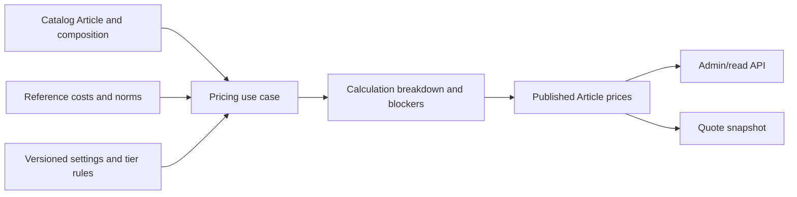

# Target design and compatibility

## Data ownership and calculation path

Catalog owns Product/Article identity and composition through SDD 002. Reference owns fabrics, accessories, operations, suppliers and their approved cost versions. A Catalog Pricing subdomain owns calculation settings/rule versions, result breakdown and published Article tier prices unless an explicit module decision assigns that ownership elsewhere. Quotes consume a published price plus a historical snapshot; they do not edit master pricing rules.

Represent percentages internally as decimal fractions (`0.2174`, `0.11`, `0.12`, `0.08`, `0.25`) and sewing multipliers separately (`1.55`, `1.32`, `1.25`). Import converts formatted percentages once; the calculation never guesses whether `21.74` means a fraction or percent. Each setting/rule has code, unit, scope, effective date, status, source and version. Material/supplier cost inputs likewise need effective values and provenance. Keep Article calculation inputs and chosen setting/rule versions with each persisted result.

Calculation returns either a typed breakdown with prices or a typed set of blockers. Do not use `0` as an error sentinel. Use `decimal` throughout and test the visible two-decimal parity fixtures. A publication record stores the exact prices presented to buyers, while an internal breakdown may retain higher precision. Do not apply an unobserved VAT multiplication.

## Current code to change

| Path | Existing role | Planned change |
| --- | --- | --- |
| `src/Modules/Catalog/Catalog.Domain/Catalog.Domain/Products/Pricing/SewingPricing.cs` | Product × Fabric formula; hard-coded shift/assembly; divisions for three labor roles | Replace/route to Article composition calculation with setting-driven multiplications; keep old API behavior until cutover. |
| `src/Modules/Catalog/Catalog.Application/Catalog.Application/Contracts/Admin/Product/ProductAdminDetailMapper.cs` | Reads `AdditionalReference` keys and calculates Product detail prices | Use pricing read service/approved published Article result after backend contract transition; do not embed a second formula in mapper. |
| `src/Modules/Catalog/Catalog.Application/Catalog.Application/Features/Product/GetAdminList/GetAdminProductsQueryHandler.cs` | Computes `minimumWholesalePrice` from old Product formula | Use one published-price projection with explicit missing-price state. |
| `src/Modules/Catalog/Catalog.Domain/Catalog.Domain/Products/Entities/Ppe/PpeProductDetails.cs` | Base price and two percent choices | Keep compatibility until new three-tier PPE rule/offer model is available. |
| `src/Modules/Reference/` | Mutable material prices and operation minutes | Expose approved effective cost/norm reads; version changes through a focused Reference SDD if schema changes. |
| `docs/sdd/contracts/catalog/product-catalog.openapi.yaml` | Current Product API | Add/version Article price operations and transition old Product price fields. |

## Migration and rollout

1. Implement Article/composition input (SDD 002), typed pricing settings/rules and effective Reference cost reads in additive schema. Current Product price response remains unchanged.
2. Implement pure sewing calculation with focused source parity fixtures and blocker tests. Load approved settings into Brevi DB through a controlled seed/import with source and effective date.
3. Add calculation/publish use cases and versioned Article price reads. Compare first model `MOD-025`, then a representative cross-category sample; record expected source precision and difference tolerance.
4. Switch Admin, storefront and future quotes through versioned API/contracts. Remove old Product pricing calculation only after consumers and tests are updated; do not leave two editable price masters.
5. Implement PPE rule lookup and approved external-price override precedence as its own dependent slice; migrate all applicable PPE rules and products, then perform the same contract/consumer transition.

The pure formula can be tested without a live database. The completed initial catalogue transfer required an empty Product catalogue; the pricing bootstrap now requires that imported batch and its source-ID mappings, plus the approved settings snapshot. Empty-Product checks must not be reused for pricing bootstrap. Rollback of a future pricing release selects a previous published price version while preserving rule/result history. Follow the repository's database and delivery rules for any EF migration.
