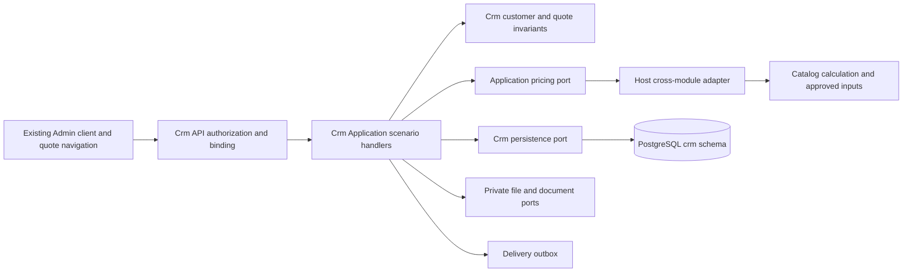

# Backend boundaries and planned file map

Follow [layer rules](../../../../standards/backend-rules.md), [database rules](../../../../standards/database-rules.md) and [ID strategy](../../../../standards/identifier-strategy.md). Crm already exists; this feature does not introduce a new Sales module. Paths below are **planned**, except explicitly marked existing.

## Owners and transaction boundaries

- Crm owns customers/contacts, quote drafts/versions, private custom composition, customer-visible presentation, issuer settings, document/delivery metadata and migration mappings.
- Catalog owns sellable Article/Product identities and approved arithmetic; Reference owns supplier/material/operation masters and input cost/norm versions. Crm stores frozen copies **as historical evidence**, not editable replacement masters.
- Identity owns actor/roles. Crm stores typed actor references; never copies accounts or source auth tables.
- Host composition bridges public Application contracts. No Crm Domain reference to Catalog EF entities, direct foreign DbContext access or cross-module navigation properties. Resolve references and source revision tokens through ports, and validate the whole coherent price basis before persistence.
- One save writes root revision + immutable version/children + event + idempotency outcome in one Crm transaction. File bytes/render/provider side effects are outside that transaction; finalize via status/outbox. There is no assumed shared IUnitOfWork or atomic transaction across modules.

## Planned map

`src/Modules/Crm/Crm.<Layer>/Crm.<Layer>/` is the existing project root pattern.

| Path under project root | Responsibility | Scenarios |
| --- | --- | --- |
| Domain/`Customers/Customer.cs`, `Contacts/CustomerContact.cs`, respective `Identifiers/` and `ValueObjects/` | Each entity/value object in its own matching file; customer/contact invariants | SC-C01–05 |
| Domain/`Quotes/Quote.cs`, `Versions/QuoteVersion.cs`, `Items/QuoteItem.cs`, `Variants/QuoteVariant.cs` | Root lifecycle, immutable version, one item and one variant; no mega aggregate file | SC-Q01–05 |
| Domain/`Quotes/Pricing/`, `Quotes/Ownership/`, `Quotes/Events/` | Snapshot values, override/transfer invariants, typed events, each primary type separate | SC-Q02–07 |
| Domain/`CustomSewing/{Drafts,Versions,Composition,Attachments,Templates}/` | Private configuration/version, line and visibility rules | SC-S01–05 |
| Domain/`Documents/{Issuer,Artifacts}/`, `Delivery/` | Issuer version, PDF metadata and delivery state | SC-D01–04 |
| Application/`Customers/{CreateCustomer,GetCustomers,GetCustomer,ReviseCustomer,MergeCustomers}/` | One CQRS scenario per folder, command/query, handler, validator and DTO each own file | SC-C01–05 |
| Application/`Quotes/{CreateQuote,SaveQuoteVersion,GetQuotes,GetQuote,PreviewQuotePrices,RepriceQuote,CopyQuote,TransferQuote,ArchiveQuote,PrepareQuote}/` | Independent orchestration, no all-purpose QuoteService | SC-Q01–07 |
| Application/`CustomSewing/{SaveDraft,Calculate,SaveVersion,GetSuggestions,ApplyTemplate,ExportProductionPackage}/` | One custom use case per folder | SC-S01–06 |
| Application/`Documents/{ReviseIssuer,RenderQuotePdf,GetQuoteArtifact}/`, `Delivery/{EnqueueQuote,GetDeliveries}/` | Separate document/delivery operations | SC-D01–04 |
| Application/`Abstractions/{Pricing,Identity,Files,Documents,Delivery,Persistence}/` | Only concrete required ports, one interface per file | Cross-module scenarios |
| Infrastructure/`Persistence/{CrmDbContext.cs,Configurations,Converters,Migrations}/` | EF mapping and migrations; one entity configuration per file | Persistence |
| Infrastructure/`Documents/`, `Delivery/`, `Files/`, `Imports/{Staging,Mapping,Reconciliation}/` | Renderer, worker/provider, private storage, isolated import adapters | SC-D*, SC-M* |
| Api/`Customers/`, `Quotes/`, `CustomSewing/`, `Documents/` | Thin controllers and individual request/response mapping files | HTTP |
| `src/Bootstrapper/Host/.../Crm/` (exact host folder selected in EN-001) | DI and cross-module port adapters; no business formulas | Integration |
| `tests/{UnitTests,IntegrationTests,ArchitectureTests}/Crm/` | Existing test projects extended by scenario, not new ad hoc test harness | All |

Use case EF read specifications live in `<UseCase>/Specifications/`, e.g. `GetCustomers/Specifications/CustomersPageSpec.cs`; do not use one generic shared Specifications directory. Paged reads use SQL projection with Ardalis.Specification and `PagedResult<IReadOnlyList<T>>`. Cross-cutting authentication/errors stay in existing pipelines. Pass CancellationToken throughout.

## Refactoring and feature map checkpoint

Keep existing Catalog/Reference APIs and engine responsibilities. Add a reusable calculation input adapter only where current engine signatures cannot handle private composition; do not fork the formula or expose private component costs through public Product DTOs. Split each added DTO/interface/handler into a matching file, group by scenario, create directories only when they contain real behavior. Review changed files and dependency tests at each slice. During implementation add `docs/sdd/features/crm/clients-and-quotes.md`, update its feature index and actual database map; do not mark planned paths as implemented now.

## Implemented customer structure after audit

The actual customer map is [clients and contacts](../../../../features/crm/clients-and-quotes.md); [audit](../code-audit/audit.md). Application uses `Customers/Access`, `Contracts/Inputs`, `Contracts/Responses`, `Mapping`, use-case-local `SaveCustomerContact/Inputs` and `GetCustomers/DTOs`. Infrastructure uses `Persistence/Customers/{Reading,Writing,Idempotency}`. `CustomerMutationStore` owns transaction/locks/error mapping; `CustomerMutationJournal` owns payload/replay/audit with the same context and transaction. The P2 quote structure is separately recorded in the [implementation audit](../code-audit/p2-implementation-audit-2026-10-26.md); later custom/document paths above remain planned.
